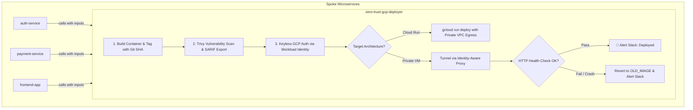

# 🚀 Zero-Trust GCP Deployment Engine

A production-grade, reusable Hub-and-Spoke GitHub Actions deployment engine for Google Cloud Platform. It enforces keyless authentication via Workload Identity Federation (OIDC), automated Trivy vulnerability scanning, strict VPC network isolation, and automated zero-downtime container rollback.

[](https://cloud.google.com/)
[](https://github.com/aquasecurity/trivy)
[-green.svg)](https://cloud.google.com/iam/docs/workload-identity-federation)
[](https://opensource.org/licenses/MIT)

---

## 📌 Architecture: The Hub-and-Spoke Pattern

Instead of duplicating complex deployment logic, bash scripts, and GCP authentication across 10+ individual microservice repositories, this repository acts as the **Centralized Deployment Hub**:



---

## 🛡️ Key Security & Reliability Pillars

1. **🔐 Keyless OIDC Authentication:** Completely eliminates permanent, leaky service account JSON keys. Temporary credentials minted per run.
2. **🔒 Embedded Trivy Security Gate:** Scans container filesystems and dependencies for `CRITICAL` or `HIGH` CVEs, automatically exporting SARIF reports to GitHub CodeQL.
3. **🌐 Zero-Trust Network Perimeter:**
   - **Cloud Run:** Directs database queries through Serverless VPC Access Connectors using `--vpc-egress=private-ranges-only`. Internal Cloud SQL instances have zero public IP exposure.
   - **Compute Engine (VM):** Transfers deployment scripts and executes commands strictly through **GCP Identity-Aware Proxy (IAP) TCP tunneling** (`--tunnel-through-iap`). No public port 22 or 5432 open.
4. **🔄 Proactive Health Probing & Fail-Fast Rollback:**
   - Detects `exited` or `dead` containers immediately to fail fast without hanging the CI runner.
   - Automatically reverts `docker-compose.yml` to the previously running container image (`OLD_IMAGE`), restores stable traffic, and pushes failure traces to Slack.

---

## 🛠️ How Downstream Microservices Use This Engine

Downstream repositories need only a lightweight caller workflow in `.github/workflows/deploy.yml`:

```yaml
name: Deploy Microservice

on:
  push:
    branches: [ main ]

jobs:
  deploy:
    uses: anjali-gambhava/zero-trust-gcp-deployer/.github/workflows/deploy-engine.yml@main
    with:
      SERVICE_NAME: 'auth-service'
      ENV_TAG: 'prod'
      DEPLOY_TARGET: 'cloudrun' # Or 'vm'
      AR_REPO: 'microservices'
      REGION: 'us-central1'
      VPC_CONNECTOR: 'serverless-vpc-connector'
    secrets:
      GCP_PROJECT_ID: ${{ secrets.GCP_PROJECT_ID }}
      WORKLOAD_IDENTITY_PROVIDER: ${{ secrets.WORKLOAD_IDENTITY_PROVIDER }}
      SERVICE_ACCOUNT: ${{ secrets.SERVICE_ACCOUNT }}
      SERVICE_ENV: ${{ secrets.SERVICE_ENV }}
      SLACK_WEBHOOK_URL: ${{ secrets.SLACK_WEBHOOK_URL }}
```

*(See complete working example in [`examples/caller-workflow.yml`](examples/caller-workflow.yml))*

---

## 📄 License & Author

- Developed by **Anjali Gambhava** ([LinkedIn](https://linkedin.com/in/anjali-gambhava))
- Licensed under the **MIT License**.
