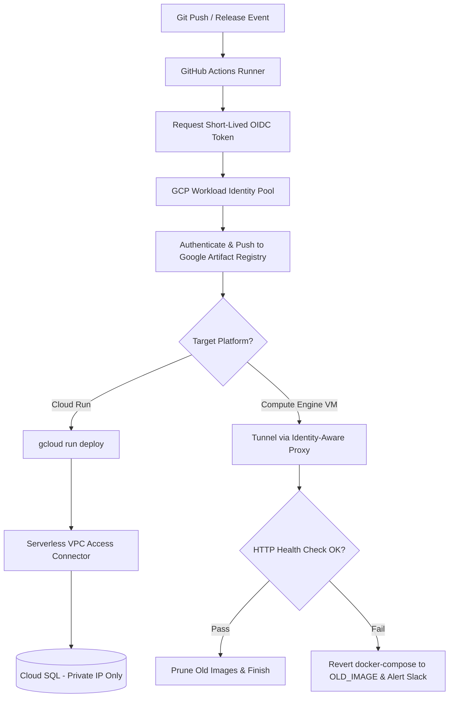

# 🚀 Zero-Trust GCP Deployment Engine

A production-grade, reusable GitHub Actions deployment workflow for Google Cloud Platform. It enforces keyless authentication via Workload Identity Federation (OIDC), strict network isolation, and automated zero-downtime container rollback.

[](https://cloud.google.com/)
[-green.svg)](https://cloud.google.com/iam/docs/workload-identity-federation)
[](https://opensource.org/licenses/MIT)

---

## 📌 The Problem It Solves

Traditional cloud deployment pipelines frequently suffer from critical security flaws and fragile rollout mechanics:
1. **Permanent Leaky Credentials:** Storing static GCP service account JSON keys inside GitHub Secrets risks credential compromise and fails SOC 2 audits.
2. **Exposed Network Endpoints:** Exposing public SSH ports (port 22) or making database ports reachable over the public internet.
3. **Failed Releases without Automated Recovery:** When a new container image crashes on startup due to a runtime syntax error or missing env var, users experience immediate downtime unless the pipeline detects it and rolls back automatically.

---

## 🛡️ Key Architectural Features

- **🔐 Keyless Authentication (OIDC):** Uses GCP Workload Identity Federation (`id-token: write`). GitHub mints temporary tokens exchanged for short-lived GCP access credentials. Zero static JSON keys.
- **🌐 Zero-Trust Network Perimeter:**
  - **Cloud Run:** Connects to internal Cloud SQL and microservices via Serverless VPC Access Connectors using `--vpc-egress=private-ranges-only`. Outbound database queries stay strictly within RFC 1918 private subnets.
  - **Compute Engine (VM):** Remote shell execution and container administration operate strictly through **GCP Identity-Aware Proxy (IAP) TCP tunneling**. The VM requires **no external public IP** and zero open inbound firewall ports.
- **🔄 Proactive Health Probing & Fail-Fast Rollback:**
  - Deployment scripts poll the application's `/health` endpoint for up to 120 seconds.
  - Detects `exited` or `dead` containers immediately to fail-fast.
  - Automatically reverts `docker-compose.yml` to the previously running image (`OLD_IMAGE`), restarts the stable container, and streams crash logs to Slack.

---

## 🏗️ Architecture Flow



---

## 🛠️ Usage Example

```yaml
# .github/workflows/deploy.yml
name: Production Deployment

on:
  push:
    branches: [ main ]

jobs:
  deploy:
    uses: anjali-gambhava/zero-trust-gcp-deployer/.github/workflows/deploy-engine.yml@main
    with:
      SERVICE_NAME: 'api-service'
      ENV_TAG: 'prod'
      DEPLOY_TARGET: 'cloudrun'
      AR_REPO: 'app-containers'
      REGION: 'us-central1'
      VPC_CONNECTOR: 'serverless-vpc-connector'
    secrets:
      GCP_PROJECT_ID: ${{ secrets.GCP_PROJECT_ID }}
      WORKLOAD_IDENTITY_PROVIDER: ${{ secrets.WORKLOAD_IDENTITY_PROVIDER }}
      SERVICE_ACCOUNT: ${{ secrets.SERVICE_ACCOUNT }}
      SERVICE_ENV: ${{ secrets.SERVICE_ENV }}
      SLACK_WEBHOOK_URL: ${{ secrets.SLACK_WEBHOOK_URL }}
```

---

## 📄 License & Author

- Developed by **Anjali Gambhava** ([LinkedIn](https://linkedin.com/in/anjali-gambhava))
- Licensed under the **MIT License**.
